# Hi, I'm Frank Arrigo 👋

**Technologist. Builder. Australian software ecosystem advocate.**

🚀 Relocating to **London in November 2026**  actively exploring senior roles in Developer Relations, Solutions Engineering, AI Product & Strategy, and Technical Leadership - open to UK, European, and remote-global roles. Best way to reach me: **[frankarr.link](https://frankarr.link)**.

I spent 40+ years at the intersection of software, people, and ideas — from mainframes at Aspect Computing to developer evangelism at Microsoft, startup mentoring at muru-D, and leading solution architecture teams at AWS.

---

## 🎯 What I'm Looking For

- **Developer Relations / Technical Evangelism** — my deepest craft, done at scale at Microsoft and AWS
- **Solutions Engineering / Architecture** — led SA teams across ANZ and APJ at AWS
- **Technical Leadership** — built and grown high-performing technical teams across APAC

Open to: leading & developing high-performing teams, enterprise SaaS, AI infrastructure, developer tools, cloud platforms.

> I'm currently running a fully automated, multi-agent AI publishing operation — 1,600+ articles, a 6-agent team, and a live content pipeline. That's AI Product & Strategy in practice, not on a slide.

---

## 🧰 What I've Built & Worked On

- **[SmallBizAI.au](https://smallbizai.au)** — AI adoption guide for Australian small businesses. 1,600+ posts, fully automated publishing pipeline, AI agent team.
- **[PickUp](https://receptionists.smallbizai.au)** — Comparing AI receptionists for AU and UK small businesses — independent mystery-call tests, real published prices, no vendor relationships
- **[Reviews](https://reviews.smallbizai.au)** — Independent AU/UK tracker of review-request tools for tradies (sister site to Pickup and SmallBizAI.au)
- **[mathmaties](https://github.com/frankarr/mathmaties)** — iOS & Android app for kids learning maths with NFC-tagged physical number tokens
- **[devevangelist](https://github.com/frankarr/devevangelist)** — Resources from my developer evangelism days
- **[frankarr-wiki](https://github.com/frankarr/frankarr-wiki)** — Historical blog pages hosted on Cloudflare Pages

---

## 🏢 Career

| Period | Where |
|--------|--------|
| 2018–2024 | **Amazon Web Services** — SA Manager ANZ, Head of SAs Territory ANZ, Head of CSC SA APJ, Head of Early Career SAs APJ |
| 2014–2018 | **Telstra** — API Strategy, CTOi Innovation Team, muru-D mentor |
| 1991–2014 | **Microsoft** — Australia, Redmond WA, ninemsn, Windows Digital Media APAC, Technical Evangelism Sydney, Seattle, Melbourne |
| 1984–1991 | **Aspect Computing** — Mainframe, Mini, PC era |

---

## ✍️ Latest posts

<!-- BLOG-POST-LIST:START -->
- [Seven attempts, zero deliveries: my week with Dragonfly Shipping](https://frankarr.com/2026/10/22/seven-attempts-zero-deliveries-my-week-with-dragonfly-shipping/)
- [Hello Cloudflare!](https://frankarr.com/2026/10/22/hello-cloudflare/)
- [The Agents I’m Using Right Now &lpar;Part 1: Setup &amp; Early Results&rpar;](https://frankarr.com/2026/10/12/the-agents-im-using-right-now-part-1-setup-early-results/)
- [The September Performance Review: How Did My AI Team Actually Do?](https://frankarr.com/2026/10/01/the-september-performance-review-how-did-my-ai-team-actually-do/)
- [Twenty Years on X &lpar;Formerly Twitter&rpar;: What 35,000 Tweets Actually Look Like](https://frankarr.com/2026/09/28/twenty-years-on-x-formerly-twitter-what-35000-tweets-actually-look-like/)
<!-- BLOG-POST-LIST:END -->

---

## 📊 GitHub Stats

## 🌏 Find Me

---

*Dad. Husband. 😇 St Kilda FC member for 40+ years (blindly optimistic). Data's grandpappy 🐕 Soon 🇦🇺🛫🛬🇬🇧*

